<p align="center">
  
</p>

<h1 align="center">VenusBar</h1>

<p align="center"><a href="../README.md">Українська</a> | <strong>English</strong></p>

<p align="center">
  <strong>Your MARSTEK battery, a glance away.</strong><br>
  A native macOS menu bar app for charge, power and outage planning.
</p>

<p align="center">
  <a href="https://github.com/tenderfog/marstek/actions/workflows/build.yml"></a>
  
  
  
</p>

<p align="center">
  <a href="https://github.com/tenderfog/marstek/releases"><strong>Download</strong></a> ·
  <a href="../CHANGELOG.md">What's new</a> ·
  <a href="#get-started">Get started</a> ·
  <a href="https://github.com/tenderfog/marstek/issues">Report an issue</a> ·
  <a href="../README.md">Українська</a>
</p>


VenusBar keeps your battery in the menu bar. Hover for a quick look; click for the full view. It talks directly to the station over your local network, without asking for your MARSTEK account credentials.

**Early alpha.** Reading has been tested on a physical **Venus E 3.0, firmware 150**. Venus A support is implemented but still needs hardware testing. Current builds are **not Apple notarized**, so macOS may block the first launch. [Installation notes →](FIRST-RUN.txt)

<table>
  <tr>
    <td width="50%" align="center" valign="top">
      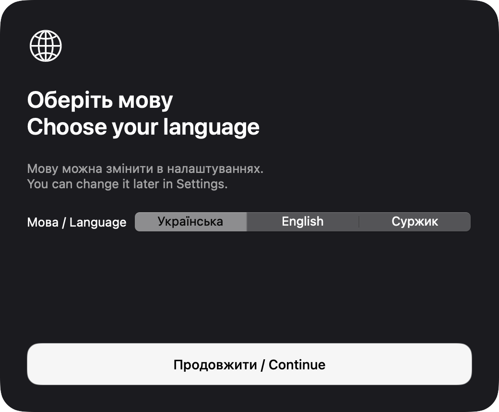<br>
      <strong>1. Choose your language</strong><br><sub>Ukrainian, English or the playful Surzhyk interface.</sub>
    </td>
    <td width="50%" align="center" valign="top">
      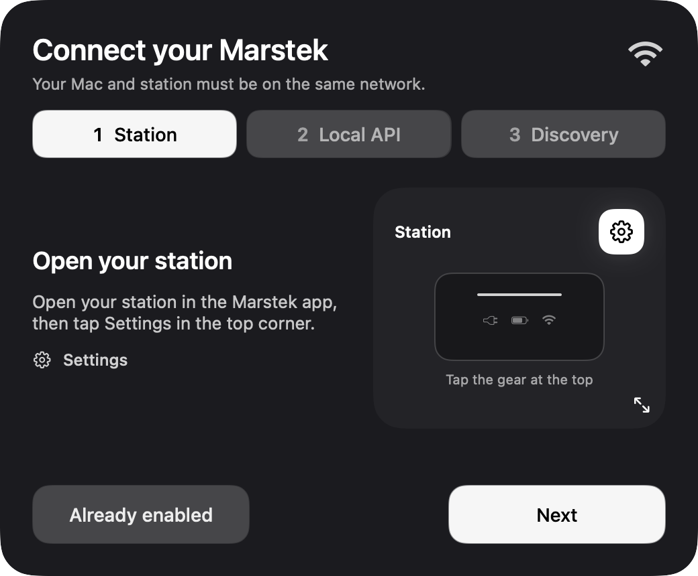<br>
      <strong>2. Open your station in MARSTEK</strong><br><sub>A short guide starts with your first launch.</sub>
    </td>
  </tr>
</table>

<sub>Actual app screens with sample readings and fictional addresses. <a href="images/README.md">Screenshot details</a>.</sub>

## Get started

1. Download **VenusBar.zip** from [Releases](https://github.com/tenderfog/marstek/releases), unzip it and move **VenusBar.app** to **Applications**.
2. Open it and choose your language. VenusBar lives in the menu bar, without a Dock icon.
3. Connect your Mac and station to the same local network. In the official MARSTEK app, enable **Local API** and check **Ports**. Use that exact UDP port; `30000` is only the default.
4. Allow Local Network access if macOS asks, then choose **Find automatically**. You can also enter the station's IP address and port manually.
5. Add an address for outage schedules, or choose **Set up later**. The schedule stays hidden until configured.

If discovery fails, check the port and **System Settings → Privacy & Security → Local Network** on macOS 15 or newer. Manual IP entry needs the same network permission. Guest Wi-Fi or client isolation can also prevent the Mac and station from communicating.

<table>
  <tr>
    <td width="50%" align="center" valign="top">
      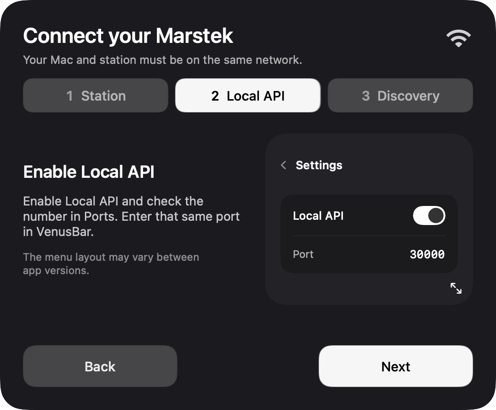<br>
      <strong>3. Enable Local API</strong><br><sub>Use the same port number shown in MARSTEK.</sub>
    </td>
    <td width="50%" align="center" valign="top">
      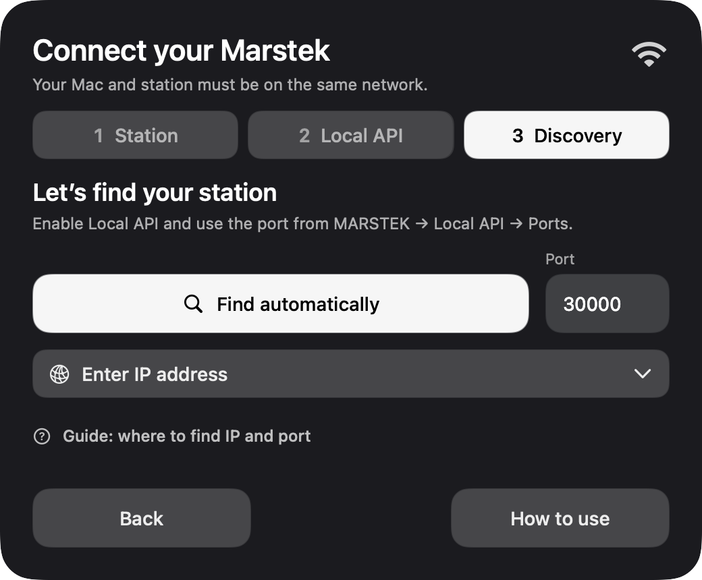<br>
      <strong>4. Find the station automatically</strong><br><sub>The model is detected from the station’s response.</sub>
    </td>
  </tr>
  <tr>
    <td width="50%" align="center" valign="top">
      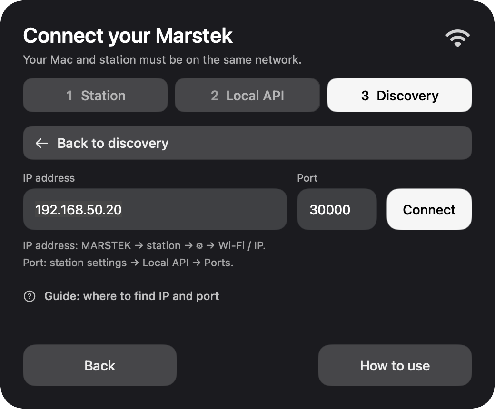<br>
      <strong>Or connect by IP address</strong><br><sub>IP and port fields, inline hints and a way back to discovery.</sub>
    </td>
    <td width="50%" align="center" valign="top">
      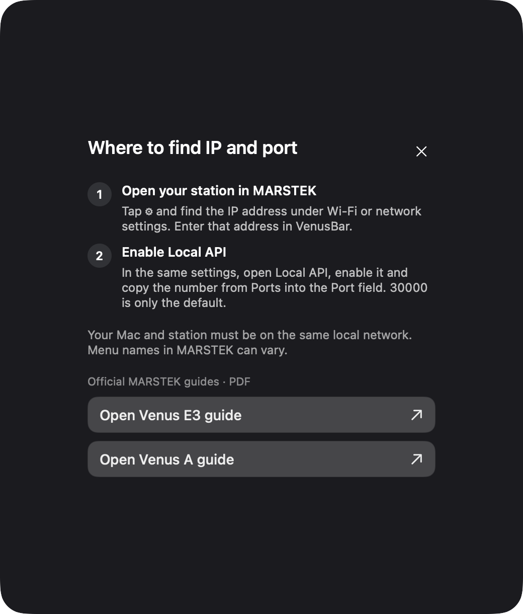<br>
      <strong>Connection help stays close</strong><br><sub>Where to find IP and port, plus the official E3 and A manuals.</sub>
    </td>
  </tr>
</table>

## A clear view of your energy

| | What you can do |
| :--- | :--- |
| **At a glance** | See battery percentage in the menu bar and a compact hover panel with active power readings, temperature and an optional daily outage timeline. |
| **Charge & discharge** | Separate power readings, remaining energy in kWh, battery temperature and load relative to a known output rating. Green means charging; red means discharging. |
| **Power history** | Explore 1 hour, 3 hours, 5 hours or a full day. Longer periods scroll horizontally. Between responses, the chart holds the last reading and shows its original time. |
| **Outage schedules** | Find your street and building through YASNO, then see today's intervals and the current time. Skip this entirely if you do not need it. |
| **Battery estimates** | Estimate time to full charge or whether the battery should last until scheduled power restoration, when sufficient battery data is available. |
| **Notifications** | Choose a consumption threshold and alerts about new VenusBar builds. Configure each separately; the master switch and macOS permission are required. Notifications are off by default. |
| **Station controls** | Access the model's supported API commands for modes, charging schedules and settings. Physical execution still needs hardware validation. |
| **Made for macOS** | SwiftUI and AppKit, dark translucent surfaces, optional launch at login, and Ukrainian, English or the playful “Surzhyk” interface. |

<table>
  <tr>
    <td width="50%" align="center" valign="top">
      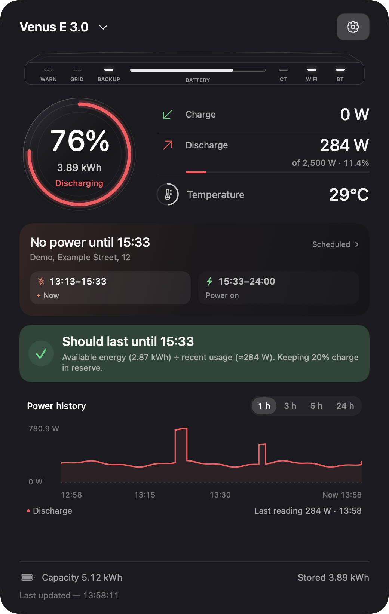<br>
      <strong>Battery status and today’s plan</strong><br><sub>Charge, discharge, temperature, estimates and power history.</sub>
    </td>
    <td width="50%" align="center" valign="top">
      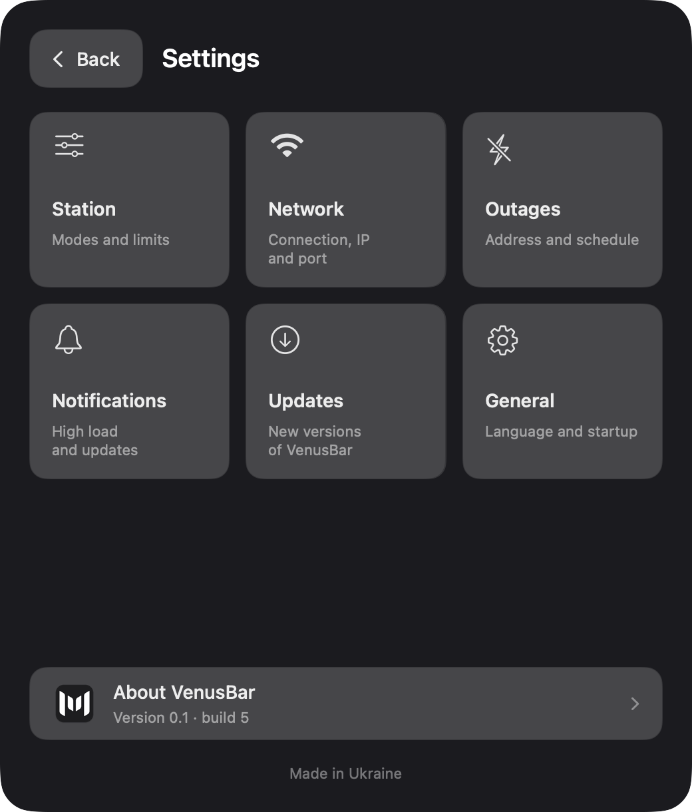<br>
      <strong>One place for your settings</strong><br><sub>Six sections and a separate About VenusBar link.</sub>
    </td>
  </tr>
  <tr>
    <td width="50%" align="center" valign="top">
      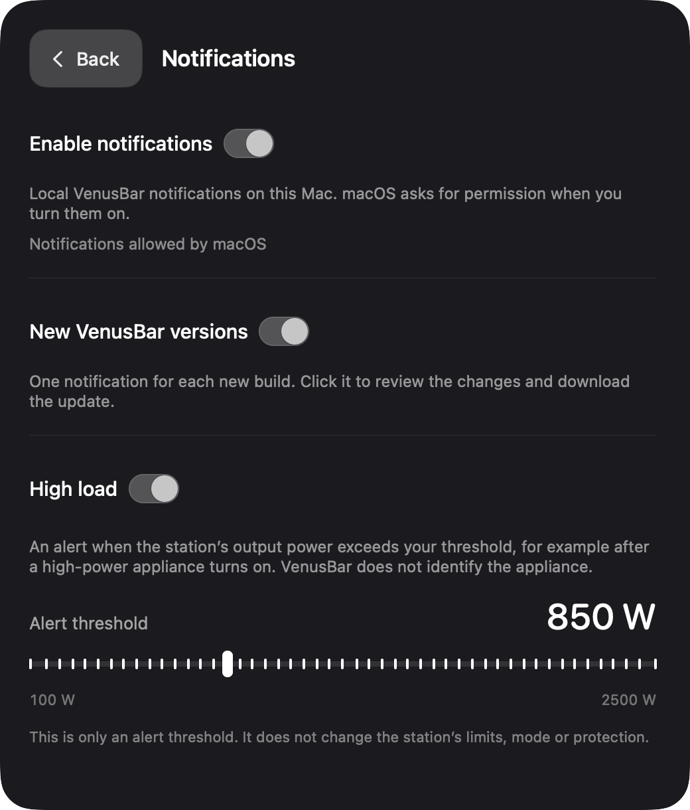<br>
      <strong>Choose the alerts you need</strong><br><sub>A consumption threshold and new-version notifications.</sub>
    </td>
    <td width="50%" align="center" valign="top">
      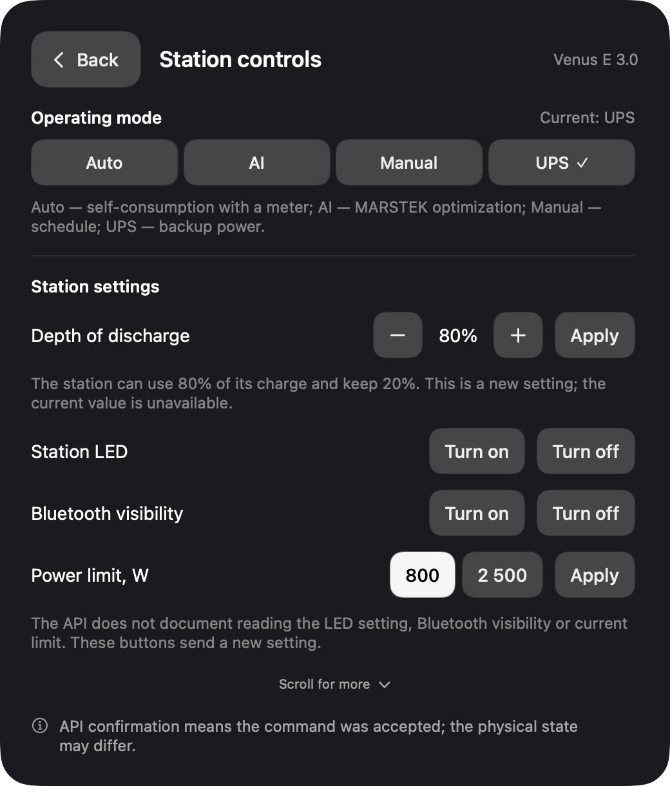<br>
      <strong>Station controls</strong><br><sub>Modes and settings; physical execution still needs testing.</sub>
    </td>
  </tr>
</table>

## Updates

Starting with **build 4**, VenusBar uses [Sparkle](https://sparkle-project.org/) for in-app updates. Open **Settings → Updates → Check for Updates**, or enable automatic checks. When a new build is found, a dedicated Download button appears in the main panel. You can also enable new-version alerts under Notifications. Review the changes, then choose whether to download, install and restart. Your station connection, address, history and preferences are kept.

Older builds need **one manual installation** of a build with the updater. Public updates are distributed through GitHub Releases; downloading them does not require a GitHub account. The updater's signatures do not replace Apple notarization or remove the first-launch restriction.

For maintainers: [how releases and signed updates are published →](RELEASING.md)

<table>
  <tr>
    <td width="50%" align="center" valign="top">
      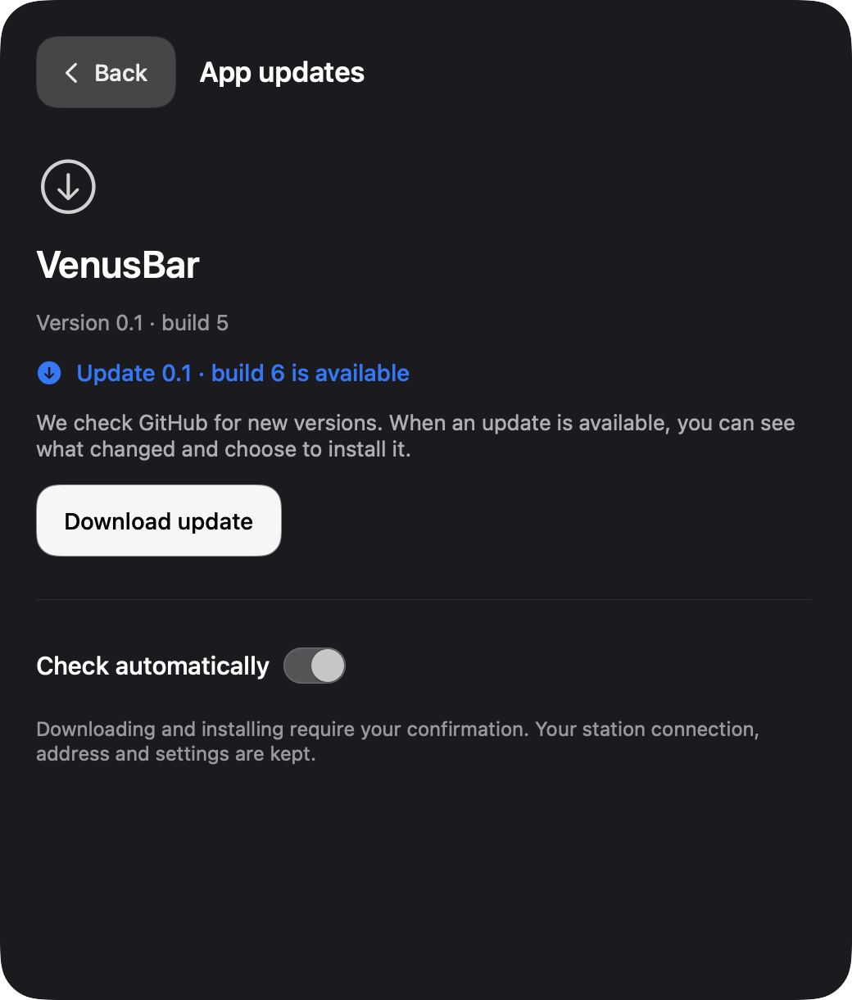<br>
      <strong>Check for new versions</strong><br><sub>Manual or automatic checks. Build 6 in this image is illustrative.</sub>
    </td>
    <td width="50%" align="center" valign="top">
      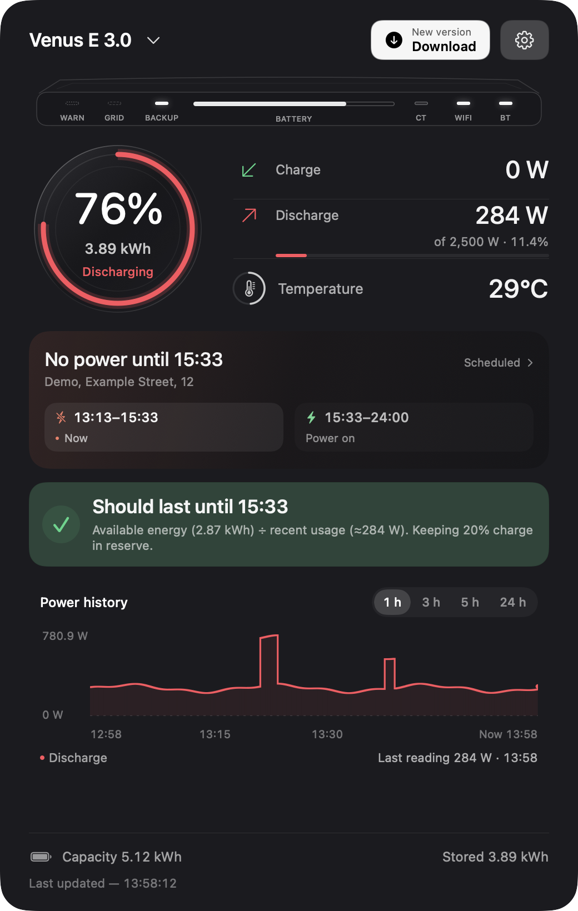<br>
      <strong>A clear update prompt</strong><br><sub>Demo state: build 6 is illustrative; no real notification was sent.</sub>
    </td>
  </tr>
</table>

## Compatibility

| | Current status |
| :--- | :--- |
| **macOS** | 13 or newer; universal build for Apple Silicon and Intel. |
| **Venus E 3.0** | Local API reading verified on firmware 150. Other firmware and wiring arrangements need testing. |
| **Venus A** | Protocol support implemented, including solar inputs when returned by the station. Real-device testing is still needed. |
| **System settings** | Require a recognized E3/A and firmware 150 or newer. Controls also require a matching known Wi-Fi/Bluetooth station identifier. An accepted API command does not confirm its physical execution. |
| **Outage schedules** | Regions and operators returned by YASNO's public service. Availability depends on that service. |

### What the readings mean

- **The outage schedule is a plan.** It is separate from station telemetry and cannot confirm that mains electricity is physically present. Zero watts alone cannot confirm it either.
- **Estimates depend on the load.** Runtime uses usable battery energy and recent battery power or an energy trend. A local reserve, initially 20%, affects the estimate; it does not change the station's discharge-depth setting.
- **Last known values remain visible.** A failed request does not erase the dashboard. Source timestamps and stale states distinguish saved readings from fresh responses.
- **LEDs are an interpretation.** The API does not expose each physical indicator directly. The drawing uses the available readings and conservative estimates.
- **Temperature colours are advisory.** The 45 / 50 / 55°C levels are VenusBar attention markers, not verified BMS shutdown thresholds. Internal battery temperature is not ambient temperature.

## Your data

Station settings, the last reading, local power history and the selected outage address live in:

```text
~/Library/Application Support/VenusBar/
```

They are not included in the app archive. Station requests stay on the local network. If you enable outage schedules, address lookup goes to YASNO. Update checks and downloads use GitHub and do not upload your station readings or saved address.

## Build from source

Use macOS 13+ with Xcode Command Line Tools and a compatible Swift/macOS SDK:

```sh
git clone https://github.com/tenderfog/marstek.git
cd marstek
zsh scripts/build_venusbar.sh
```

The script fetches a pinned, checksum-verified Sparkle release, builds the app, signs the local build ad hoc, runs offline checks and creates:

```text
build/VenusBar.app
build/VenusBar.zip
```

Run the checks again with:

```sh
build/VenusBar.app/Contents/MacOS/VenusBar --self-check
```

These checks cover protocol parsing, command limits, timestamps and application logic. They do not search your network or send commands to a station. Python may be used during packaging for a toolchain workaround; the finished app needs no Python runtime.

## Help make it better

Found a bug? [Open an issue](https://github.com/tenderfog/marstek/issues) with your macOS version, VenusBar build, station model, firmware and the exact error. Remove addresses, IP/MAC addresses, Wi-Fi names and other private details from screenshots or logs before posting.

Small fixes, clearer translations and results from Venus A testing are welcome. See [the changelog](../CHANGELOG.md) for development history and [release instructions](RELEASING.md) for the publishing process.

---

**Зроблено в Україні · Made in Ukraine**

Developed by [tenderfog](https://github.com/tenderfog) · [tenderfog.site@gmail.com](mailto:tenderfog.site@gmail.com)

VenusBar is an independent, unofficial project and is not affiliated with MARSTEK. The app icon uses the manufacturer's mark; [source and attribution](../Assets/AppIcon/SOURCE.md). Third-party components and their licences are listed in [THIRD_PARTY_NOTICES.md](../THIRD_PARTY_NOTICES.md).
