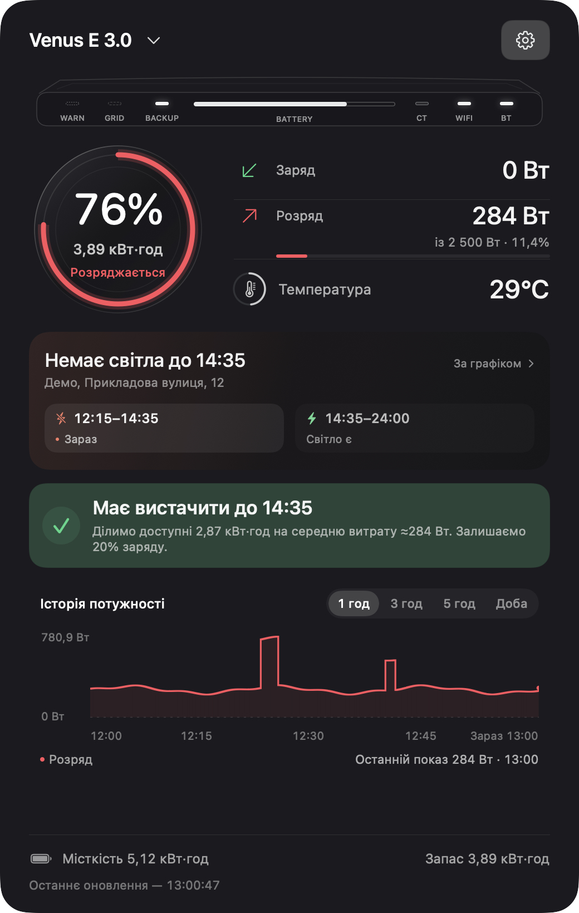
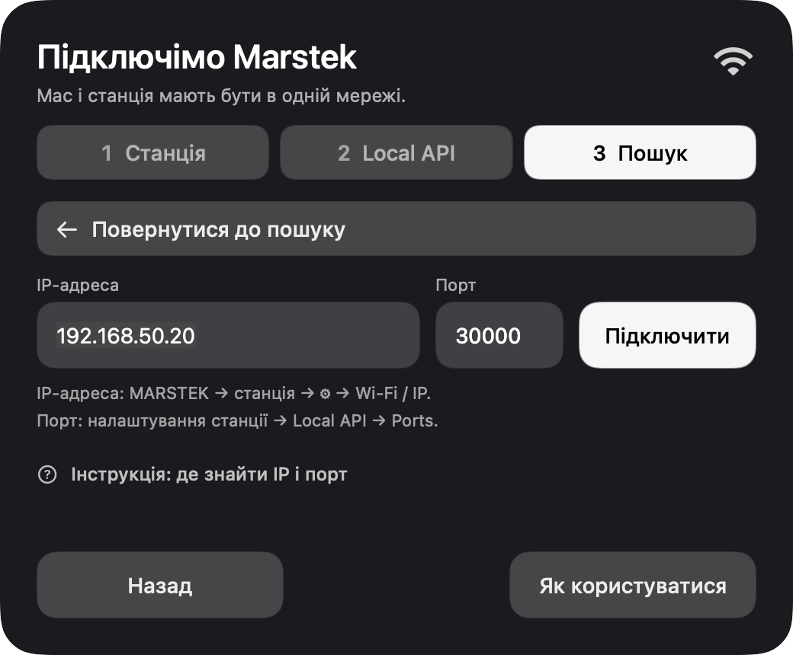
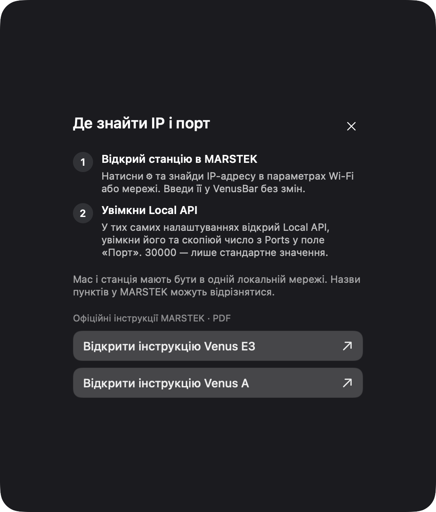

<p align="center">
  
</p>

<h1 align="center">VenusBar</h1>

<p align="center">
  <strong>Твоя MARSTEK — завжди під рукою.</strong><br>
  Заряд, потужність і графіки відключень у рядку меню macOS.
</p>

<p align="center">
  <a href="https://github.com/tenderfog/marstek/releases"><strong>Завантажити</strong></a> ·
  <a href="../CHANGELOG.md">Історія змін</a> ·
  <a href="#перший-запуск">Перший запуск</a> ·
  <a href="https://github.com/tenderfog/marstek/issues">Повідомити про проблему</a> ·
  <a href="../README.md">English</a>
</p>

<p align="center">
  
  <br><sub>Справжній інтерфейс із демонстраційними показами та вигаданою адресою. <a href="images/README.md">Про знімки екрана</a>.</sub>
</p>

Наведи курсор на значок VenusBar, щоб швидко перевірити станцію, або натисни для повного огляду. Застосунок спілкується зі станцією безпосередньо в локальній мережі й не просить пароль від облікового запису MARSTEK.

**Тестова версія 0.1.** Читання перевірено на реальній **Venus E 3.0 з прошивкою 150**. Підтримку Venus A реалізовано, проте ще потрібно перевірити на реальній станції. Збірки **не мають нотаризації Apple**, тому macOS може заблокувати перше відкриття. [Інструкція встановлення →](FIRST-RUN.txt)

## Що вміє VenusBar

| | Можливості |
| :--- | :--- |
| **Короткий огляд** | Відсоток заряду в рядку меню. При наведенні — активні покази потужності, температура та необов'язковий графік відключень із позначкою поточного часу. |
| **Заряд і розряд** | Окремі показники потужності, запас енергії у кВт·год, температура й частка навантаження від відомої потужності виходу. Зелений — заряд, червоний — розряд. |
| **Історія потужності** | Періоди 1, 3, 5 годин або доба. Довгі графіки прокручуються горизонтально. Між відповідями лінія утримує останній показ; час його отримання вказано окремо. |
| **Графіки відключень** | Пошук вулиці й будинку через YASNO, сьогоднішні інтервали та поточний час. Без налаштованої адреси цей блок прихований. |
| **Прогноз батареї** | Приблизний час до повного заряду та оцінка, чи вистачить енергії до планового ввімкнення світла, коли є достатньо даних батареї. |
| **Сповіщення** | Власний поріг споживання у ватах. Після його перевищення — локальне повідомлення. Потрібно ввімкнути функцію й надати дозвіл macOS. |
| **Керування станцією** | Доступні для моделі API-команди режиму, розкладу заряджання й налаштувань. Фізичне виконання команд ще потребує перевірки. |
| **Нативний macOS** | SwiftUI та AppKit, темне напівпрозоре оформлення, автозапуск за бажанням, українська, англійська та жартівливий «Суржик». |

## Перший запуск

Потрібні **macOS 13 або новіша** та станція з увімкненим Local API. Збірка універсальна: Apple Silicon та Intel.

1. Завантаж **VenusBar.zip** у [Releases](https://github.com/tenderfog/marstek/releases), розпакуй і перенеси **VenusBar.app** у **Програми**.
2. Відкрий VenusBar й обери мову. Застосунок працює через значок у рядку меню, без іконки в Dock.
3. Підключи Mac і станцію до тієї самої локальної мережі. У застосунку MARSTEK увімкни **Local API** та подивись значення **Ports**. У VenusBar вкажи той самий UDP-порт; `30000` — лише стандартне значення.
4. Дозволь доступ до локальної мережі, якщо macOS його запитає, і натисни **«Шукати автоматично»**. За потреби введи IP-адресу й порт вручну.
5. Додай адресу для графіків або обери **«Налаштувати пізніше»**.

Якщо станція не знаходиться, перевір порт. У macOS 15 або новішій перевір **Системні параметри → Приватність і безпека → Локальна мережа**. Дозвіл потрібен і для ручного введення IP. Гостьовий Wi-Fi та ізоляція клієнтів також можуть перешкоджати зв'язку.

<details>
  <summary>Переглянути підключення та вбудовану інструкцію</summary>
  <p align="center">
    
    <br><sub>Автоматичний пошук або ручне підключення з портом станції.</sub>
  </p>
  <p align="center">
    
    <br><sub>Посилання на офіційні інструкції Venus E3 та Venus A доступні в застосунку.</sub>
  </p>
</details>

## Оновлення

Починаючи зі **збірки 4**, оновлення встановлюються через [Sparkle](https://sparkle-project.org/). Відкрий **Налаштування → Оновлення застосунку → Перевірити оновлення** або ввімкни автоматичну перевірку. Переглянь зміни й обери завантаження та встановлення. Після перезапуску підключення, адреса, історія та параметри збережуться.

Старі збірки потребують **одного ручного встановлення** версії з оновлювачем. Для завантаження опублікованих релізів обліковий запис GitHub не потрібен. Підпис Sparkle не замінює нотаризацію Apple й не прибирає обмеження першого запуску.

[Для розробника: публікація версій і підписаних оновлень →](RELEASING.md)

## Що вже перевірено

| | Стан підтримки |
| :--- | :--- |
| **Venus E 3.0** | Читання локального API перевірено на прошивці 150. Інші прошивки та схеми підключення потребують тестування. |
| **Venus A** | Підтримку протоколу реалізовано, включно із сонячними входами за наявності цих даних. Потрібна перевірка на реальній станції. |
| **Системні налаштування** | Лише для визначеної E3/A з прошивкою 150 або новішою. Для керування також має збігатися відомий Wi-Fi/Bluetooth-ідентифікатор станції. Прийняття команди API не підтверджує її фізичного виконання. |
| **Графіки відключень** | Регіони й оператори, які повертає публічний сервіс YASNO. Доступність залежить від цього сервісу. |

### Як читати показники

- **Графік — це план оператора.** Він не підтверджує фактичну наявність електрики. Нуль ватів сам собою також не доводить її наявності чи відсутності.
- **Автономність залежить від споживання.** Оцінка враховує доступну енергію й потужність батареї або перевірений тренд енергії. Початковий резерв 20% змінює лише прогноз, без зміни глибини розряду станції.
- **Останні покази залишаються на екрані.** Помилка запиту не стирає дані. Час відповіді та нейтральна індикація допомагають відрізнити збережені покази від свіжих.
- **LED-індикатори відтворено за непрямими даними.** API не дає окремого стану кожного фізичного світлодіода.
- **Кольори температури — орієнтири уваги.** Рівні 45 / 50 / 55°C не є підтвердженими порогами захисту BMS. Температура всередині батареї відрізняється від температури довкілля.

## Дані та приватність

Підключення, останній показ, історія та обрана адреса зберігаються локально:

```text
~/Library/Application Support/VenusBar/
```

Ці дані не входять до архіву застосунку. Запити до станції залишаються в локальній мережі. Якщо налаштовано графіки, пошук адреси звертається до YASNO. Перевірка й завантаження оновлень використовують GitHub без передавання показів станції чи збереженої адреси.

## Зібрати з вихідного коду

Потрібні Xcode Command Line Tools і сумісні Swift та macOS SDK:

```sh
git clone https://github.com/tenderfog/marstek.git
cd marstek
zsh scripts/build_venusbar.sh
```

Скрипт завантажує зафіксовану версію Sparkle з перевіркою SHA-256, збирає застосунок, ставить локальний ad hoc підпис, виконує офлайн-перевірки й створює `build/VenusBar.app` та `build/VenusBar.zip`.

Повторити перевірки:

```sh
build/VenusBar.app/Contents/MacOS/VenusBar --self-check
```

Вони перевіряють парсинг протоколу, межі команд, часові мітки й логіку застосунку, без пошуку в мережі та без команд станції. Під час пакування може використовуватися Python для обходу проблеми інструментів збірки; готовому застосунку Python не потрібен.

## Зворотний зв'язок

[Створи issue](https://github.com/tenderfog/marstek/issues) і вкажи версію macOS, збірку VenusBar, модель станції, прошивку та точний текст помилки. Перед публікацією прибери зі знімків і журналів адресу, IP/MAC, назву Wi-Fi та інші приватні дані.

Вітаються невеликі виправлення, покращення перекладів і результати тестування Venus A. [Історія змін →](../CHANGELOG.md)

---

**Зроблено в Україні**

Розробник — [tenderfog](https://github.com/tenderfog) · [tenderfog.site@gmail.com](mailto:tenderfog.site@gmail.com)

VenusBar — незалежний неофіційний проєкт, не пов'язаний із MARSTEK. Для піктограми використано знак виробника: [джерело й атрибуція](../Assets/AppIcon/SOURCE.md). Ліцензії сторонніх компонентів: [THIRD_PARTY_NOTICES.md](../THIRD_PARTY_NOTICES.md).
